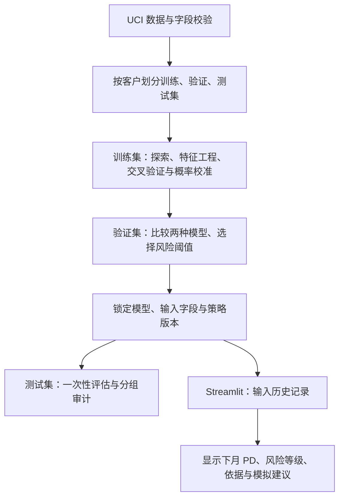

# 个人信用风险评分与智能授信决策系统

**Credit Risk Scoring System** · 金融科技 / 金融风控 / 数据科学入门项目 · 预计 3–4 周

本项目模拟一次存量持卡人授信复评。以 2005 年 9 月账单周期结束为评分时点，根据过去六个月的账单和还款记录估计客户下月违约的概率。当人工复核名额有限时，哪些客户可以模拟通过，哪些应当送审？项目计划用同一组预测结果比较不同策略，并通过本地 Streamlit 应用展示单笔客户的评估过程。

> **当前进度**　阶段 ①–③ 已完成，阶段 ④（Streamlit 演示）待开发。数据校验与训练集探索见 [`reports/eda_report.md`](reports/eda_report.md)；建模、阈值策略、测试集评估与分组审计见 [`reports/model_report.md`](reports/model_report.md)；适用边界见 [`reports/model_card.md`](reports/model_card.md)。最终模型为未校准的逻辑回归，策略为 `t1 = 0.15`、`t2 = 0.40`，测试集 ROC-AUC 0.776、AP 0.546、Brier 0.136。`pytest` 14 项通过。论文插图由 `python -m src.paper_figures` 生成。

## 背景与目标

消费金融团队复评存量客户时，误放高风险客户可能产生坏账，误拒正常客户也会损失业务机会。审核团队每天能够复核的人数也有限。

| 问题 | 计划交付 |
| --- | --- |
| 历史还款行为能否区分下月违约客户？ | 用逻辑回归和随机森林对同一批客户评分，与只输出训练集违约率的基准比较。 |
| 风险分值能否当作概率读？ | 输出下月违约概率（PD），按概率区间比较平均预测值与实际违约率。 |
| 调整阈值会影响谁？ | 模拟通过、人工复核和暂缓授信三种处理方式，比较通过率、复核量、通过组违约率及群体差异。 |

## 数据源与字段

UCI *Default of Credit Card Clients*（编号 350）收录 30,000 名台湾地区信用卡客户。每行代表一名客户，含一个 ID、23 个候选特征和一个二元标签。观察期为 2005 年 4–9 月，目标为 10 月是否违约。金额单位为新台币（NT$）。[UCI 数据说明与下载](https://archive.ics.uci.edu/dataset/350/default+of+credit+card+clients)

| 字段（UCI 接口名） | 业务含义 | 首版处理 |
| --- | --- | --- |
| `ID` | 客户标识 | 用于查重、核对划分和关联审计表，排除在模型输入之外。 |
| `LIMIT_BAL`（`X1`） | 客户已有的授信额度 | 作为历史输入。数据没有“应授予的新额度”标签。 |
| `SEX`、`EDUCATION`、`MARRIAGE`（`X2–X4`） | 性别、教育程度、婚姻状况的类别编码 | 性别仅供审计。对教育和婚姻类别做独热编码，单列字典未解释的值。 |
| `AGE`（`X5`） | 年龄，单位为岁 | 核查取值范围，并按预先定义的年龄段审计。 |
| `PAY_0`、`PAY_2` 至 `PAY_6`（`X6–X11`） | 依次对应 9、8、7、6、5、4 月的还款状态（六列，无 `PAY_1`） | 正值表示逾期月数。原说明将 `-1` 定义为按时还款。对 `-2`、`0` 等未明确解释的编码保留原值并单独统计。 |
| `BILL_AMT1` 至 `BILL_AMT6`（`X12–X17`） | 9 月至 4 月的月度账单金额 | 逐月核对分布和负值，保留可解释的余额变化。 |
| `PAY_AMT1` 至 `PAY_AMT6`（`X18–X23`） | 同一顺序的月度实还金额 | 与还款**状态**区分，可计算近六个月平均实还金额。 |
| `default payment next month`（`Y`） | 下月是否违约，`1` 为违约，`0` 为未违约 | 统一命名为 `target`，仅用于分层划分、训练标签和评估。 |

原始 Excel 的第二行是业务字段名，接口版使用 `X1` 至 `X23` 和 `Y`。载入时按上表逐列映射，并检查唯一 ID、标签取值、金额单位和月份方向。UCI 标注无缺失值，实际读取时仍应分别核对空值和未知编码。

## 技术栈与架构

首版采用本地 Python 单体应用。Pandas、NumPy 用于清洗和特征计算，Jupyter、Matplotlib 用于探索和作图。scikit-learn 的 `ColumnTransformer` 和 `Pipeline` 封装预处理与分类器，Joblib 保存推理所需对象。Streamlit 读取同一模型和策略配置。



## 项目目录结构（规划）

```text
Fintech/
├── README.md                         # 当前交付
├── requirements.txt                  # 以下均为计划文件或目录
├── .gitignore
├── data/
│   ├── raw/                          # 本地保存原始数据与来源记录
│   └── processed/                    # 清洗结果及固定划分索引
├── notebooks/
│   ├── 01_data_analysis.ipynb
│   ├── 02_model_results.ipynb
│   └── 03_policy_and_test.ipynb
├── src/
│   ├── data_loader.py
│   ├── preprocessing.py
│   ├── feature_engineering.py
│   ├── metrics.py
│   ├── train.py
│   ├── policy.py                     # 验证集选阈值，锁定策略
│   ├── paper_figures.py              # 按论文版面重画插图
│   ├── evaluate.py
│   └── prediction.py                 # 批量评估与页面共用的推理入口
├── models/
│   ├── credit_risk_model.joblib       # 含预处理及所选概率模型
│   └── policy.json                   # 阈值、输入字段与配套模型版本
├── reports/
│   ├── eda_report.md
│   ├── model_report.md
│   └── model_card.md                  # 适用人群、审计与已知限制
├── tests/
│   ├── test_prediction.py
│   └── test_policy.py
└── app.py
```

## 四阶段开发计划

| 阶段 | 工作与交付物 | 预计用时 |
| --- | --- | --- |
| ① 数据分析与准备 | 校验字段，固定客户划分。在训练集探索额度、年龄、逾期和违约的关系。绘制字段分布、相关性热力图、按违约状态的账单分布、按额度分组的违约率、按逾期月数分组的违约率，写入 `eda_report.md`。 | 3–4 天 |
| ② 特征工程与建模 | 尝试近六个月逾期次数、最大逾期月数和平均还款额。为逻辑回归标准化数值特征，为两种模型处理类别特征。用训练集内的分层交叉验证选择超参数并拟合校准器，将候选模型放到同一验证集比较。 | 5–7 天 |
| ③ 风险策略与评估 | 在验证集比较至少三组阈值，按复核容量与风险偏好选定方案。冻结模型和策略后，完成测试集评估、性别和年龄分组审计，输出 `model_report.md` 和 `model_card.md`。 | 3–4 天 |
| ④ 本地产品演示 | 用 Streamlit 接收并校验额度、历史状态和账单等字段，展示 PD、风险等级、建议和六个月内逾期次数等依据。若选逻辑回归，可解释各特征对校准前对数几率的贡献。若选随机森林，在展示全局重要性时单列该客户的历史记录。 | 5–7 天 |

## 数据泄漏防控

1. **固定评分时点。** 只使用截至 9 月账单周期结束时已知的信息。六个月历史保留在同一客户行内，严禁引入 10 月还款、标签副本或由结果反推的特征。
2. **先划分，再探索。** 核对 ID 唯一性，按违约标签分层，以固定随机种子（计划取 42）划分训练 / 验证 / 测试集，比例为 70% / 15% / 15%。保存划分索引并检查 ID 交集为空。用于选择特征的图表只看训练集。
3. **只在训练折拟合。** 插补值、缩放参数、类别字典、特征筛选都放入管道，在每个交叉验证训练折拟合。若尝试重采样，也仅处理训练折。验证和测试保留原始类别比例。[scikit-learn 数据泄漏说明](https://scikit-learn.org/stable/common_pitfalls.html)
4. **留出独立评估。** 若校准概率，用训练集内部交叉验证，让校准器使用折外预测。验证集用于比较模型、校准效果和阈值。锁定选择后才读取测试结果。记录数据版本、划分、依赖和配置，以便复现同一次实验。[概率校准说明](https://scikit-learn.org/stable/modules/calibration.html)

## 模型评价指标

统一以“违约”为正类。违约率基准、逻辑回归与随机森林在同一验证集上比较。最终报告注明样本量、正类占比和选定阈值。阈值类指标统一将 `PD ≥ 高风险阈值` 记为预测正类。

| 评价角度 | 指标与读法 |
| --- | --- |
| 排序能力 | **ROC-AUC** 衡量随机取一名违约和一名未违约客户时，违约客户得分更高的能力。**KS** 取各阈值下真阳性率与假阳性率之差的最大值。 |
| 违约识别 | 画 Precision–Recall 曲线，报告梯形积分的 **PR-AUC**，另列 **AP**（`average_precision_score`）并注明算法。结合当前样本的违约占比解读。[AP 定义](https://scikit-learn.org/stable/modules/generated/sklearn.metrics.average_precision_score.html) |
| 阈值表现 | **Precision** 为高风险组中实际违约的比例，**Recall** 为实际违约者中进入高风险组的比例。报告混淆矩阵、F1 和 Accuracy，并列出误拦的未违约人数与遗漏的违约人数。 |
| 概率质量 | **Brier Score** 是预测概率与 0/1 标签之差的平方均值，越低越好。用校准曲线逐段比较平均预测概率与观察违约率，同时列出每段人数。 |

**实测结果。** 详见 [`reports/model_report.md`](reports/model_report.md)。

| 模型 | 数据 | ROC-AUC | KS | AP | Brier |
| --- | --- | --- | --- | --- | --- |
| 基准（训练集违约率） | 验证集 | 0.500 | 0.000 | 0.221 | 0.172 |
| 逻辑回归 | 验证集 | 0.784 | 0.433 | 0.569 | 0.1325 |
| 随机森林 | 验证集 | 0.788 | 0.442 | 0.572 | 0.1314 |
| **逻辑回归（最终模型）** | **测试集** | **0.776** | **0.425** | **0.546** | **0.136** |

两种模型的 AUC 差值的 95% bootstrap 区间为 [−0.003, 0.013]，包含 0，按预先声明的规则选逻辑回归。测试集 4,500 人，违约占 22.11%；以 PD ≥ 0.40 为预测正类时 Precision 0.624、Recall 0.414。测试集在模型和阈值锁定后只评估了一次。

## 风险阈值与公平性

设 `p` 为校准后或经验验证过的下月违约概率，`0 < t1 < t2 < 1`。同一模型的分值固定，改变阈值就能观察复核工作量与漏放风险如何变化。

| 概率区间 | 风险等级 | 演示动作 |
| --- | --- | --- |
| `p < t1` | 低 | 模拟通过 |
| `t1 ≤ p < t2` | 中 | 进入人工复核队列，最终结果未知 |
| `p ≥ t2` | 高 | 模拟暂缓授信，展示触发的高风险规则 |

**如何选阈值。** 可在验证集试算 `(0.10, 0.30)`、`(0.15, 0.40)`、`(0.20, 0.50)` 三组候选值。这些数值只是教学情景。为每组列出通过率、复核率（各组人数 / 总人数）、通过组违约率（通过组违约人数 / 通过组人数）、高风险召回率及误拦率。先声明可用的复核名额和可接受的通过组违约率，再在满足约束的方案中比较通过人数。若均不满足，记录约束冲突。

**如何审计群体差异。** 主模型排除 `SEX`，审计表保留性别和年龄段。使用相同阈值，分组报告样本量、违约人数、通过率、复核率、误拦率（高风险未违约人数 / 组内未违约人数）和漏报率（未标为高风险的违约人数 / 组内违约人数）。另外统计漏放率（直接通过的违约人数 / 组内违约人数）。复核队列的最终审批结果不可观察，单独列示。分母为零记为 `N/A`。小样本组标注不确定性。即使排除性别，其他字段仍可能反映群体差异，审计结论仅适用于所观察的样本。

## 安装与运行

### 现在即可核验数据源

在项目根目录打开 Windows PowerShell，使用 Python 3.11。即使目录中只有 README，也可用以下命令独立核验数据。

```powershell
py -3.11 -m venv .venv
.\.venv\Scripts\python.exe -m pip install ucimlrepo
.\.venv\Scripts\python.exe -c "from ucimlrepo import fetch_ucirepo; d = fetch_ucirepo(id=350); print(d.data.features.shape, d.data.targets.shape)"
```

预期分别为 `(30000, 23)` 和 `(30000, 1)`，前者只计候选特征。也可从 UCI 页面下载并解压 `default of credit card clients.xls`，放入 `data/raw/`。读取原始文件可安装 `xlrd`，使用 `pandas.read_excel(path, header=1)`。两条路径均需保留字段映射和来源记录。[UCI 下载页](https://archive.ics.uci.edu/dataset/350/default+of+credit+card+clients)

### 项目实现后可复现实验并启动应用

以下为计划命令。待目录中的模块、依赖清单和测试就绪后，从根目录按序执行。训练与策略选择应先生成匹配的模型和策略文件，页面加载这两个文件即可预测。

```powershell
.\.venv\Scripts\python.exe -m pip install -r requirements.txt
.\.venv\Scripts\python.exe -m src.data_loader   # 获取数据，生成固定划分
.\.venv\Scripts\python.exe -m src.train         # 训练、校准、验证集比较，保存模型
.\.venv\Scripts\python.exe -m src.policy        # 验证集比较阈值，锁定策略
.\.venv\Scripts\python.exe -m src.evaluate      # 按锁定配置生成测试报告
.\.venv\Scripts\python.exe -m pytest
.\.venv\Scripts\python.exe -m streamlit run app.py
```

依赖清单计划锁定 Python 3.11 下实测的 pandas、numpy、ucimlrepo、scikit-learn、matplotlib、jupyter、joblib、streamlit 和 pytest 版本。应用启动后在浏览器打开终端给出的本地地址。模型或策略缺失时，页面应提示需要生成的文件。

## 验收标准（前三项已验收，产品待开发）

- [x] **数据**　可从 UCI 获取 30,000 条记录，解释 23 个候选特征。记录特殊编码、ID 唯一性与划分检查结果。`eda_report.md` 至少含五张有业务解释的图及分组统计。
- [x] **模型**　用一致的划分比较基准、逻辑回归和随机森林。保存最终管道。相同输入在保存前和重新加载后的 PD 一致（允许浮点误差）。
- [x] **策略与评估**　验证集报告至少三组阈值的比较。模型卡记录最终阈值、选择理由、测试集指标、校准曲线、群体审计与适用边界。各档人数之和等于评估样本数。
- [ ] **产品**　本地页面能完成一次录入与预测，显示 PD、等级、建议和历史依据。覆盖缺字段、非法输入及阈值恰好等于 `t1`、`t2` 的情形。同一客户的页面与离线结果一致。

## 数据和模型限制

- **适用人群和时间。** 样本来自 2005 年台湾地区已有信用卡的客户。新客和历史被拒者缺少同等的还款记录。客户随机留出只能评估同一时期的区分能力，对其他地区、时期或新客的效果需另行验证。
- **授信与损失。** 数据提供下月违约标签和既有额度，缺少完整违约损失率（LGD）、违约风险敞口（EAD）、回收金额及复核结果。离线策略能统计历史样本的分层表现，无法据此确定最优额度、利率、真实利润或预期信用损失。
- **模型解释。** 历史逾期、账单和评分之间的关联不代表因果关系。页面应标明历史事实、模型估计和策略动作，使用公开样本或虚构输入，仅供学习与演示。

## 后续升级

1. **模型与解释**　沿用同一划分，引入 LightGBM、XGBoost，与现有模型比较排序和校准。用 SHAP 解释单笔预测，区分个体贡献与全局重要性。
2. **数据与服务**　用 SQL 整理多表历史记录，在 Home Credit 等申请人数据上重新定义目标和评分时点。加入跨期留出验证，再用 FastAPI 提供预测接口。
3. **审核辅助**　用检索增强生成（RAG）检索风控规则，生成带有规则出处、模型版本和评分依据的复核摘要，供审核员核对。

## 简历成果（待完成后填写）

下列条目均为模板。完成对应验收后，将方括号替换为可在报告、测试记录或演示中核实的内容，再用于简历。

- **数据分析〔待完成〕**　基于 UCI 信用卡数据分析六个月的账单与还款行为，以〔训练集图表或分组结果〕说明〔具体发现〕。
- **信用建模〔待完成〕**　比较逻辑回归和随机森林，以〔选择依据〕确定模型，留出测试集 ROC-AUC 为〔实测值〕、AP 为〔实测值〕、Brier Score 为〔实测值〕。
- **风险策略〔待完成〕**　评估〔实际组数〕组候选阈值，在〔复核容量假设〕下比较模拟通过组违约率和群体误拦率，记录〔观察到的权衡〕。
- **产品开发〔待完成〕**　通过 Streamlit 展示单笔客户的违约概率、风险等级与历史依据，以〔演示或测试记录〕验证页面与离线预测一致。

## 许可与引用建议

- **数据**　UCI 以 CC BY 4.0 发布该数据集。使用或再分发时署名作者、注明来源、链接许可证，并标明清洗、重编码等改动。仓库计划通过 `.gitignore` 排除本地原始数据，提供获取步骤。[数据集](https://doi.org/10.24432/C55S3H) · [CC BY 4.0 许可](https://creativecommons.org/licenses/by/4.0/)
- **数据集引用**　Yeh, I. (2009). *Default of Credit Card Clients* [Dataset]. UCI Machine Learning Repository. [DOI 10.24432/C55S3H](https://doi.org/10.24432/C55S3H)
- **研究背景引用**　Yeh, I.-C., & Lien, C.-H. (2009). *The comparisons of data mining techniques for the predictive accuracy of probability of default of credit card clients*. Expert Systems with Applications. [论文 DOI](https://doi.org/10.1016/j.eswa.2007.12.020)
- **项目代码**　代码许可待作者确定。发布原创代码时可选用 MIT 等许可证，并在根目录添加相应的 `LICENSE`。数据继续按 UCI 标明的许可使用。
