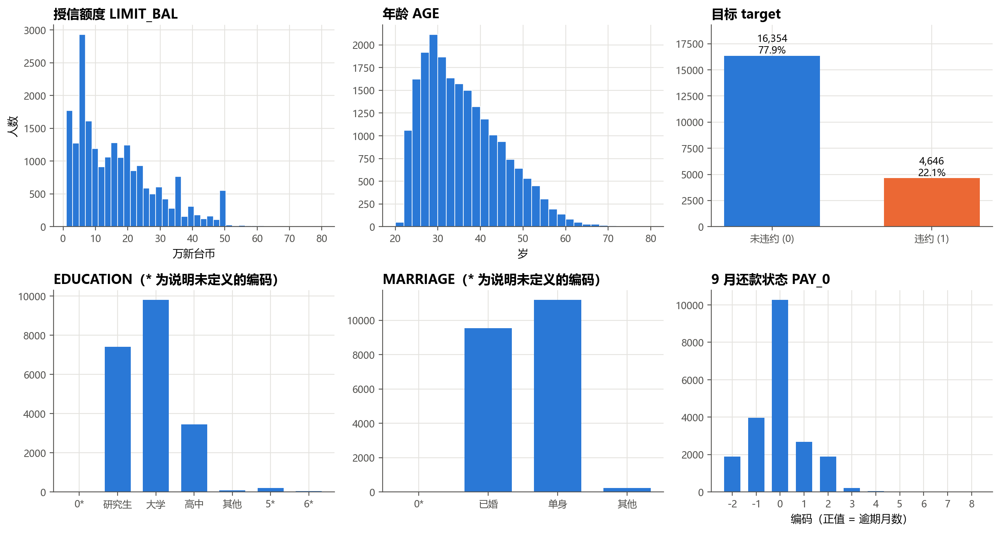
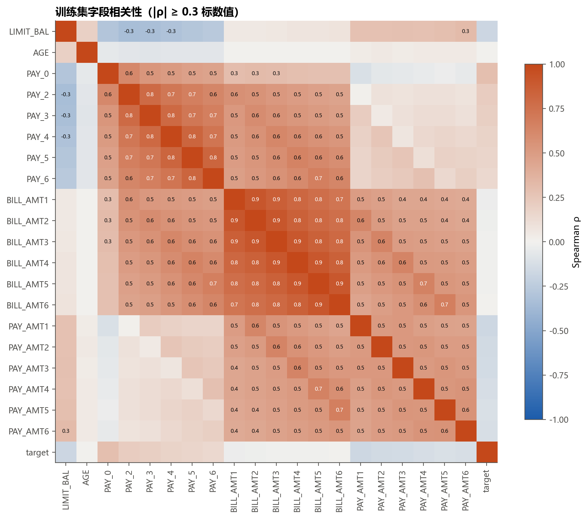
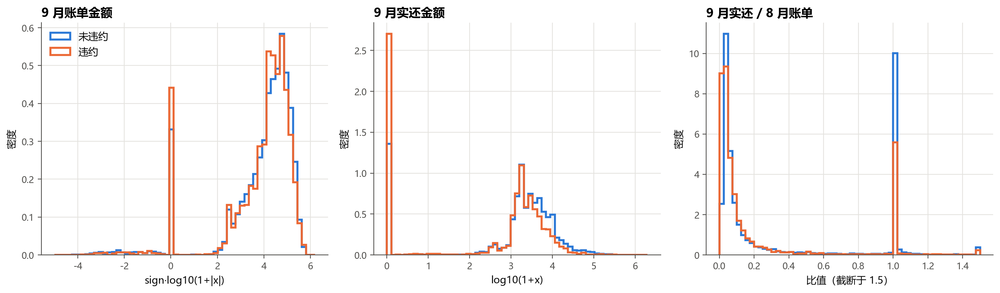
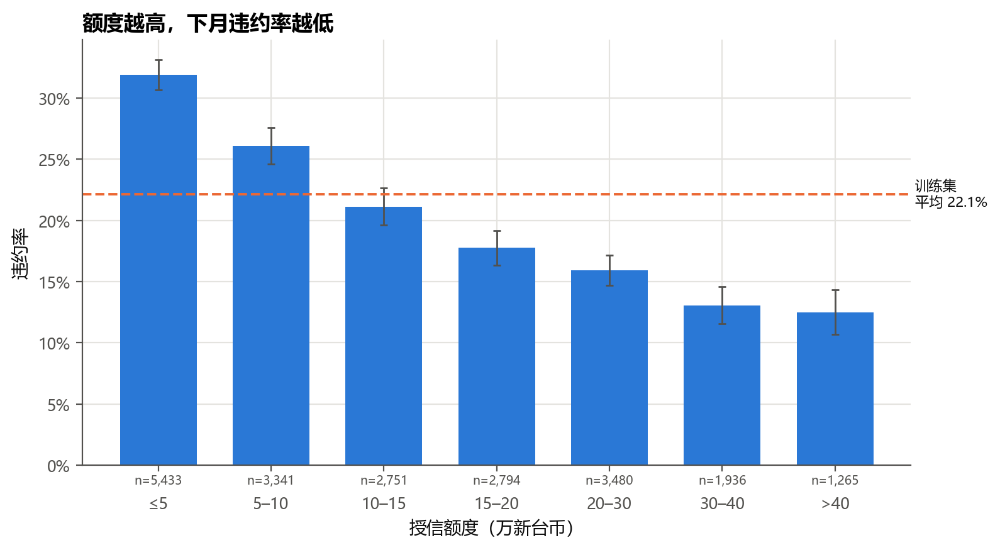
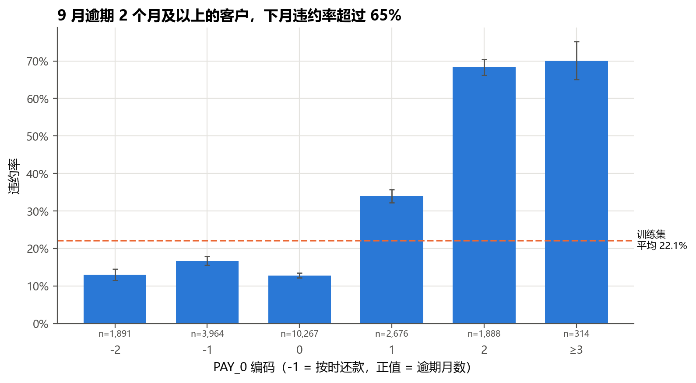
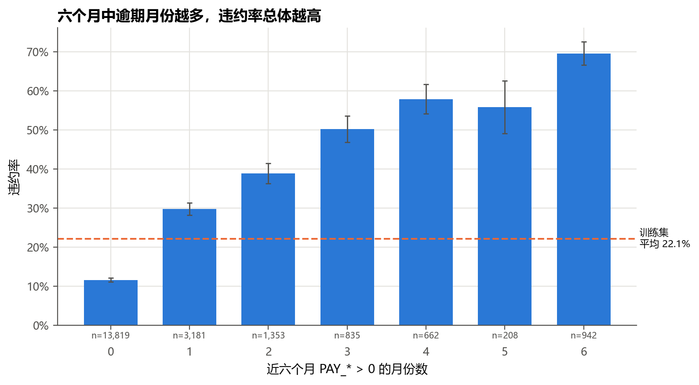
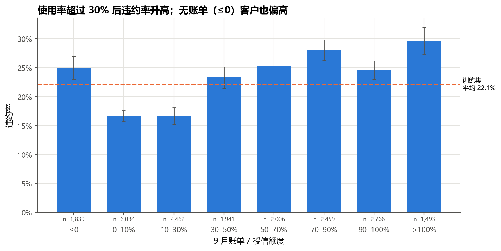
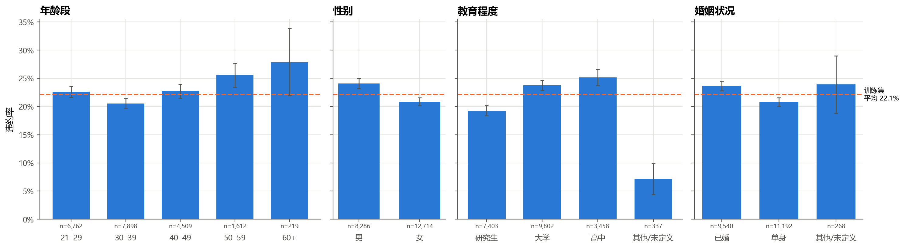

# 探索性数据分析报告（阶段 ①）

> 范围：只用**训练集**（21,000 人，违约 4,646 人，违约率 22.12%）。验证集和测试集在本阶段没有读取。
> 复现：`python -m src.data_loader` 生成划分 → 执行 `notebooks/01_data_analysis.ipynb`。图在 `reports/figures/`，分组数字在 `reports/eda_tables.json`。
> 图中误差线为违约率的 95% 正态近似区间（±1.96·√(p(1−p)/n)），小样本组的区间较宽，解读时需注意。

## 1. 数据校验结果（全量 30,000 条）

| 检查项 | 结果 | 处理 |
| --- | --- | --- |
| 形状 | 30,000 行；ID + 23 个候选特征 + target | 与 UCI 说明一致 |
| ID 唯一性 | 唯一，范围 1–30,000 | 用作划分键 |
| 缺失值 | 0 个空单元格 | 无需插补 |
| 标签 | 0：23,364；1：6,636；违约率 22.12% | 统一命名为 `target` |
| 去掉 ID 后完全重复的行 | 35 行 | 保留（不同客户可能记录相同），在报告中注明 |
| `EDUCATION` 未定义编码 | 0：14，5：280，6：51 | 建模时并入“其他/未定义”类 |
| `MARRIAGE` 未定义编码 | 0：54 | 并入“其他/未定义”类 |
| `PAY_*` 的 −2 与 0 | 原说明未解释；占各月 58%–72% | 保留原值，作为独立类别对待 |
| `PAY_2`–`PAY_6` 中的编码 1 | 仅 34 次（`PAY_0` 有 3,688 次） | 数据集已知的编码不一致，见第 3 节 |
| 账单金额为负 | 每月 590–688 行 | 视为溢缴款（贷方余额），保留 |
| 实还金额为负 | 0 行 | — |
| 年龄 / 额度范围 | 21–79 岁；1 万–100 万新台币 | 无异常值 |

**划分**（分层、种子 42）：训练 21,000 / 验证 4,500 / 测试 4,500，三组违约率分别为 22.12% / 22.11% / 22.11%。三组 ID 两两交集为 0，并集覆盖全部 30,000 个 ID。重复运行 `src.data_loader` 会重算划分并与已保存的 `split.csv` 比对，确保可复现。

## 2. 主要发现

### 图 1 字段分布

- 额度右偏，四分之一的客户在 5 万及以下。取值集中在少数整数档位：最常见的是 5 万（2,390 人），其次是 2 万、3 万、8 万、20 万，反映发卡时常用的额度档位。
- 年龄集中在 25–40 岁。
- 违约与未违约约为 22 : 78。类别不算极端失衡，但 Accuracy 仍会偏乐观，后续以 ROC-AUC、PR-AUC 和 Brier 为主。
- `PAY_0` 中最常见的是 0（10,267 人），其次是 −1 和 1。

### 图 2 相关性（Spearman）

- 与 `target` 相关最强的是还款状态：`PAY_0` ρ = 0.29，往前逐月递减到 `PAY_6` 的 0.14。**越近的月份越有信息量。**
- `LIMIT_BAL`（−0.17）和各月实还金额（−0.12 至 −0.17）与违约负相关。
- 账单金额本身与违约几乎不相关（|ρ| ≤ 0.03），但六个月账单之间高度相关（0.7–0.9）。这意味着：
  - 逻辑回归直接放入六列账单会有多重共线性，系数难解释，应考虑正则化或改用汇总特征（均值、使用率）；
  - 账单要和额度、实还金额组合起来才有用（见图 3、图 7）。

### 图 3 按违约状态的账单与还款分布

- 9 月账单：两组分布几乎重合（中位数 2.33 万 vs 2.01 万），单看账单区分不了。
- 9 月实还金额：违约组 **28.9%** 当月实还为 0，未违约组为 14.5%；实还为 0 的客户违约率 36.1%。
- 实还 / 上月账单：未违约组 25.1% 的人还清（比值 ≥ 1），违约组只有 13.7%。**还款比例是值得构造的特征。**

### 图 4 按授信额度分组的违约率

额度与违约率单调负相关：≤5 万组 31.9%，>40 万组 12.5%。额度本身是银行此前审批的结果，反映了既有的风险判断，因此它在模型中是强特征，但不能解读为“提高额度会降低违约”。

### 图 5 按 9 月还款状态分组的违约率

| PAY_0 | −2 | −1 | 0 | 1 | 2 | ≥3 |
| --- | --- | --- | --- | --- | --- | --- |
| 人数 | 1,891 | 3,964 | 10,267 | 2,676 | 1,888 | 314 |
| 违约率 | 13.0% | 16.8% | 12.8% | 34.0% | 68.3% | 70.1% |

- 逾期 1 个月的违约率是平均水平的 1.5 倍；逾期 2 个月及以上超过 68%。这是最强的单变量信号。
- −2、−1、0 三类违约率都低于平均，且 −1（按时还款）反而略高于 0。这说明三种编码代表不同的账户状态，**不能当作连续数值直接排序**；建模时 `PAY_*` 宜同时保留数值形式和“是否逾期”的指示。

### 图 6 近六个月逾期月份数（特征工程预览）

六个月都未逾期的客户（13,819 人，占 66%）违约率 11.6%；逾期 1 个月为 29.7%；六个月都逾期为 69.5%。整体单调上升（5 个月组 55.8% 略低于 4 个月组，但样本只有 208 人，区间重叠）。**“近六个月逾期次数”确认可作为阶段 ② 的特征。**

### 图 7 额度使用率（9 月账单 / 额度）

- 使用率 0–30% 时违约率最低（约 16.6%），超过 30% 后升至 23%–30%。
- 账单 ≤ 0（无欠款或溢缴）的客户违约率 25.0%，反而偏高。原因可能是这一组里有停用或异常账户，关系不是单调的，因此**使用率适合分段处理或交给树模型**，逻辑回归中可加“账单 ≤ 0”指示变量。

### 图 8 人口属性分组违约率

- 年龄：30–39 岁最低（20.5%），50 岁以上偏高（25.6%–27.9%），60+ 只有 219 人，区间很宽。
- 性别：男 24.1%，女 20.8%。**按计划，性别不进入模型，只用于阶段 ③ 的分组审计。**
- 教育：研究生 19.3% < 大学 23.7% < 高中 25.2%；“其他/未定义”组仅 7.1%（337 人）。未定义编码的违约率显著偏低，可能是数据整理时的特殊群体，合并为一类后需在报告中说明。
- 婚姻：已婚 23.6%，单身 20.8%，差异不大。

## 3. 数据问题与处理决定

1. **`PAY_*` 编码不一致。** 说明中 1 表示“逾期 1 个月”，但 `PAY_2`–`PAY_6` 几乎没有 1，而 2 的数量与 `PAY_0` 的 1 相当。较可能的解释是不同月份的编码规则不同。处理：不重编码，保留原值；派生特征以“> 0 视为逾期”为准，这一定义不受该问题影响。
2. **−2 / 0 未定义。** 结合数据，−2 中约 32% 当月账单 ≤ 0，可能代表“无消费”；0 可能代表“按最低还款额还款”。这只是推测，论文中按“未定义编码，保留原值”表述。
3. **未定义的教育 / 婚姻编码**：合并为“其他/未定义”，独热编码。
4. **负账单**：保留，并在使用率特征中单独处理 ≤ 0 的情况。

## 4. 对阶段 ② 的输入

| 计划特征 | 依据 |
| --- | --- |
| 近六个月逾期月份数（`PAY_* > 0` 的个数） | 图 6 单调上升 |
| 最大逾期月数 `max(PAY_*)` | 图 5：逾期 ≥2 月违约率跃升 |
| 最近一月是否逾期（`PAY_0 > 0`） | `PAY_0` 是最强单变量 |
| 平均实还金额、当月实还为 0 的指示 | 图 3：实还为 0 的违约率 36.1% |
| 还款比例 `PAY_AMTk / BILL_AMT(k+1)`（分母 ≤0 时单独处理） | 图 3：还清比例两组差 11 个百分点 |
| 额度使用率 `BILL_AMT1 / LIMIT_BAL` 及“账单 ≤ 0”指示 | 图 7：非单调 |
| 去掉 `SEX`；`EDUCATION`、`MARRIAGE` 合并未定义编码后独热 | 第 3 节 |

所有派生特征都只用同一客户 4–9 月的字段逐行计算，不使用任何跨样本统计量；需要拟合参数的步骤（标准化、独热字典）放进 `Pipeline`，只在训练折上拟合。
