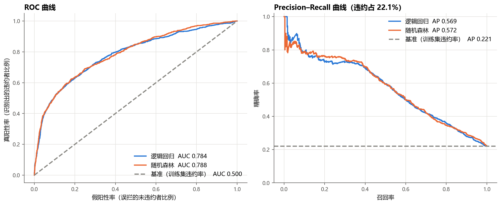
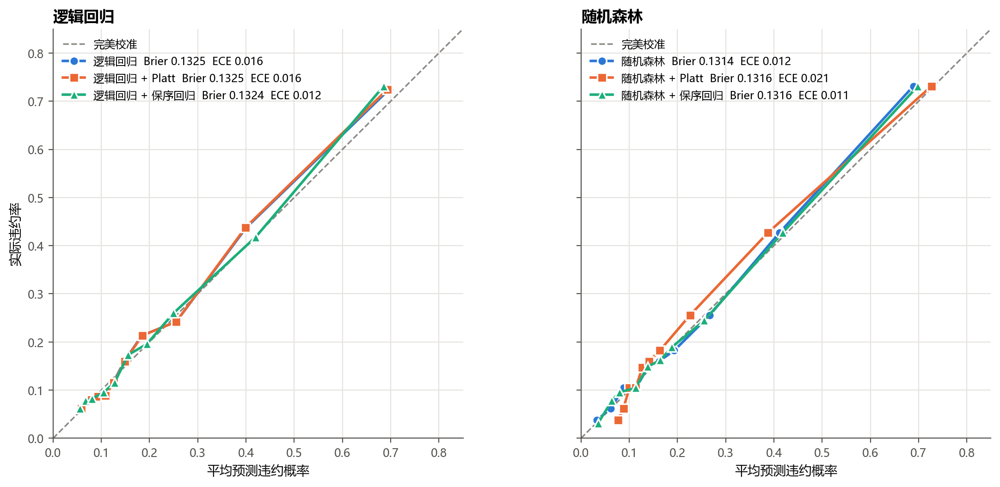
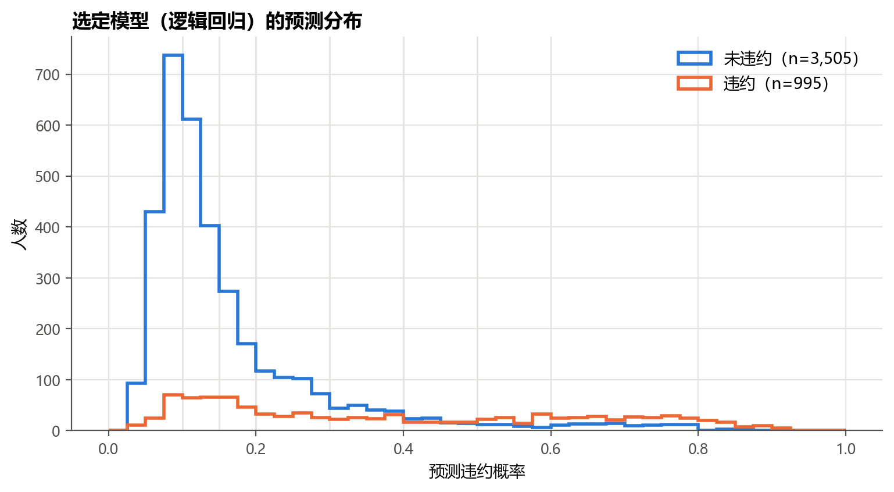
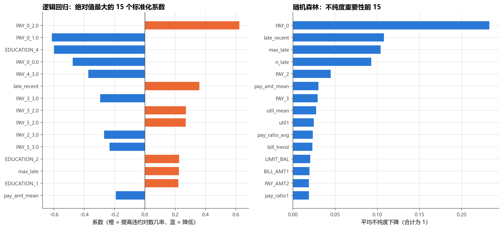
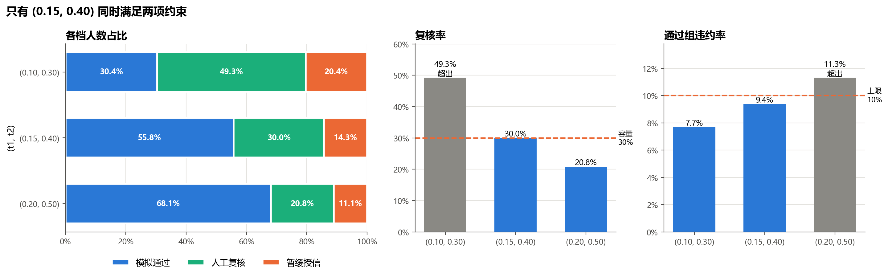
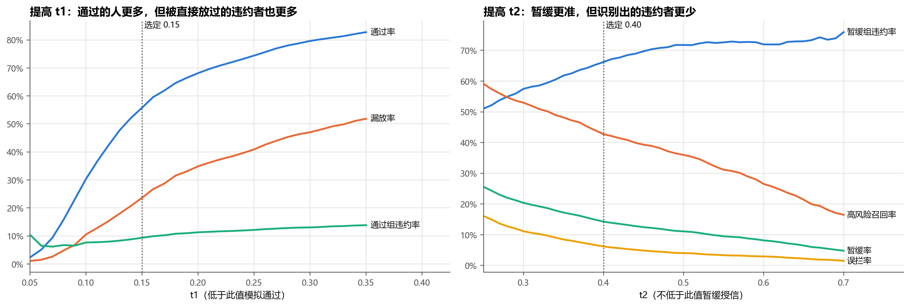
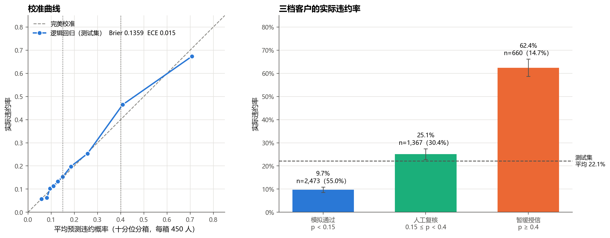
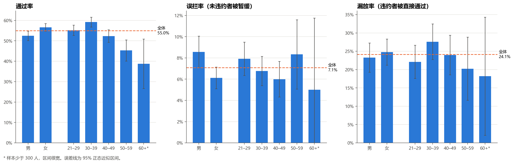

# 模型报告（阶段 ②–③：建模、校准、阈值策略与测试集评估）

> 数据使用：训练集（21,000 人）用于交叉验证、调参、特征消融和拟合校准器；验证集（4,500 人，违约 995 人，22.11%）用于比较候选模型（第 2–5 节）和选阈值（第 7 节）；**测试集（4,500 人）只在模型和阈值锁定之后读取了一次**（第 8–9 节），读取记录在 `reports/test_eval_log.json`。
> 复现：`python -m src.train`（约 5 分钟）→ `python -m src.policy` → `python -m src.evaluate`，再执行 `notebooks/02_model_results.ipynb` 和 `03_policy_and_test.ipynb` 作图。数字来自 `reports/model_results.json`、`policy_results.json`、`test_results.json`。

## 1. 实验设置

| 项目 | 设置 |
| --- | --- |
| 输入 | 22 个原始字段（排除 `ID`、`SEX`）+ 11 个派生特征（`src/feature_engineering.py`，逐行计算）。`EDUCATION` 的 0/5/6 并入“其他”，`MARRIAGE` 的 0 并入“其他” |
| 逻辑回归预处理 | 金额列做对称对数变换后标准化；其他数值列标准化；`PAY_*` 截断到 [−2, 3] 后独热；类别列独热 |
| 随机森林预处理 | 数值列（含 `PAY_*`）原样输入；类别列独热 |
| 基准 | 对所有客户输出训练集违约率（`DummyClassifier(strategy="prior")`） |
| 调参 | 训练集分层 5 折 CV（种子 42），以 ROC-AUC 选参。逻辑回归 C ∈ {0.001, 0.01, 0.1, 1, 10}；随机森林 300 棵树，max_depth ∈ {8, 14, 不限}、min_samples_leaf ∈ {10, 40}、max_features ∈ {sqrt, 0.33} |
| 校准 | `CalibratedClassifierCV(cv=5, ensemble=False)`：用训练集 5 折**折外预测**拟合 Platt（sigmoid）或保序回归（isotonic）校准器，基模型在全训练集重拟合 |
| 防泄漏 | 派生特征逐行计算、无跨样本统计量；标准化和独热编码都在 Pipeline 内，只在训练折上拟合；`SEX` 与 `ID` 不进入模型（测试 `test_sex_and_id_not_used` 验证改动二者不影响预测） |

**选择规则（在查看验证集结果之前写入 `src/train.py`）：**
1. 模型族：比较两族未校准版本的验证集 ROC-AUC，用配对 bootstrap（2,000 次）求差值的 95% 区间。区间不含 0 时选 AUC 高者，否则选逻辑回归（更易解释）。
2. 校准方式：在所选模型族内选验证集 Brier Score 最低的一种。

第 3 条平局规则是看到验证集结果后补充的，见第 4 节。

## 2. 训练集交叉验证：调参与特征消融

| 模型 | 特征 | 最优超参数 | CV ROC-AUC（均值 ± 标准差） | CV Brier |
| --- | --- | --- | --- | --- |
| 逻辑回归 | 原始字段 | C = 0.01 | 0.7735 ± 0.0031 | 0.1371 |
| 逻辑回归 | 原始 + 派生 | C = 0.1 | **0.7786** ± 0.0044 | 0.1355 |
| 随机森林 | 原始字段 | depth 14, leaf 40, sqrt | 0.7840 ± 0.0027 | 0.1349 |
| 随机森林 | 原始 + 派生 | depth 14, leaf 40, 0.33 | **0.7869** ± 0.0042 | 0.1339 |

派生特征使两种模型的 CV AUC 分别提高 0.005 和 0.003，Brier 也同步下降，因此两族都采用“原始 + 派生”。提升幅度与折间标准差（约 0.003–0.004）相当，**说明派生特征有帮助但作用有限**：原始的 `PAY_*` 已包含大部分信息，派生特征主要是把它重新组织成更易用的形式。

## 3. 验证集比较

| 候选 | ROC-AUC | KS | PR-AUC（梯形） | AP | Brier | Log loss | ECE |
| --- | --- | --- | --- | --- | --- | --- | --- |
| 基准（训练集违约率） | 0.5000 | 0.000 | N/A¹ | 0.2211 | 0.1722 | 0.5283 | 0.021 |
| 逻辑回归 | 0.7835 | 0.433 | 0.5689 | 0.5692 | 0.1325 | 0.4250 | 0.016 |
| 逻辑回归 + Platt | 0.7835 | 0.433 | 0.5689 | 0.5692 | 0.1325 | 0.4251 | 0.016 |
| 逻辑回归 + 保序回归 | 0.7832 | 0.430 | 0.5690 | 0.5561 | **0.1324** | 0.4248 | 0.012 |
| 随机森林 | **0.7884** | **0.442** | 0.5711 | **0.5716** | **0.1314** | **0.4210** | 0.012 |
| 随机森林 + Platt | 0.7884 | 0.442 | 0.5711 | 0.5716 | 0.1316 | 0.4229 | 0.021 |
| 随机森林 + 保序回归 | 0.7872 | 0.436 | 0.5746 | 0.5574 | 0.1316 | 0.4215 | 0.011 |

¹ 常数得分没有排序能力，PR 曲线只有两个端点，梯形积分会得到 0.61 这一无意义的数值。基准的识别能力以 AP = 违约占比（0.221）为准。这也说明 README 中“PR-AUC 与 AP 同时报告并注明算法”是必要的。

**配对 bootstrap：** AUC(随机森林) − AUC(逻辑回归) = 0.0049，95% 区间 [−0.0034, 0.0132]，**包含 0**。

### 读法

- **两个模型都明显优于基准**：Brier 从 0.172 降到 0.131–0.133（约降 23%），Log loss 从 0.528 降到 0.42 左右，AP 从 0.22 升到约 0.57。
- **随机森林略好，但差距在抽样误差范围内。** ROC 曲线几乎重合，两条 PR 曲线在召回率 0.4 以后也基本重合。
- **校准提升很小。** 未校准的逻辑回归已经接近对角线（ECE 0.016），因为它以对数损失为目标拟合，本身就输出概率。Platt 对逻辑回归几乎是恒等变换；随机森林在 `min_samples_leaf=40` 时也已较好校准，Platt 反而让 ECE 从 0.012 升到 0.021。
- **保序回归会产生并列得分。** 它是分段常数函数，验证集上逻辑回归 + 保序回归只有 57 个不同的概率值，因此 AP 下降约 0.013，AUC 略降。

## 4. 模型选择

1. bootstrap 区间包含 0 → 模型族选**逻辑回归**。
2. 逻辑回归三种校准的 Brier：保序回归 0.13243 < 未校准 0.13246 < Platt 0.13249。按规则 2 应选**保序回归**。
3. **平局规则（看到验证集结果后补充）。** 保序回归只以 0.00003 的 Brier 优势胜出，远小于任何有意义的差异，却带来两个对阈值策略不利的副作用：
   - 概率变成离散台阶：验证集上只有 57 个不同取值，0.45–0.50 之间没有任何客户。阈值落在台阶之间时，结果对阈值不敏感；落在台阶上时，一大批并列客户会整体换档。
   - 出现 PD = 0：1 名客户的预测概率恰好为 0，在信用风险语境中不可信。

   因此补充规则：**Brier 与最低值相差不足 0.001 的方案视为相同，按“未校准 → Platt → 保序回归”的顺序选最简单者。** 三种方案都在这一范围内，于是选**未校准**。这条规则写在 `src/train.py` 的 `TIE_RULE` 中，`models/model_meta.json` 同时记录了按规则 2 本应选出的方案（`rule2_choice`）。论文中应如实说明它是事后补充的。

最终模型：**逻辑回归（原始 + 派生特征，C = 0.1），不另做校准**，保存为 `models/credit_risk_model.joblib`。它在验证集上的 ROC-AUC 为 0.7835，AP 为 0.5692，Brier 为 0.1325，ECE 为 0.016。校准曲线基本贴着对角线（图 10 左），说明逻辑回归直接输出的概率已经可以当作违约概率来读。

预测概率连续分布在 0.016–0.923 之间（4,500 人有 4,498 个不同取值），没有空档。违约客户的分布明显偏右，但两类客户在 0.1–0.3 区间大量重叠：这一段有 49.3% 的验证集客户，违约率 16.4%，覆盖了全部违约者的 36.5%。阶段 ③ 的“人工复核”档主要就落在这一段。

## 5. 模型解释

- **随机森林**：重要性最高的是 `PAY_0`（9 月还款状态），其次是三个派生的逾期特征 `late_recent`、`max_late`、`n_late`，与 EDA 中“最近一月的逾期状态是最强信号”一致。不纯度重要性偏向取值多的连续变量，只作排序参考。
- **逻辑回归**：系数最大的也都是还款状态。但 `PAY_*` 的独热列与 `late_recent`、`max_late` 高度共线，单个系数的正负不能单独解读。例如 `PAY_0 = 1` 的系数为负，是因为它的风险已由 `late_recent`（+0.36）和 `max_late` 承担。解释时应把同一字段的独热列和相关派生特征合起来看；阶段 ④ 的页面可展示按字段分组的贡献。
- `EDUCATION_4`（含未定义编码）系数为 −0.60，对应 EDA 中该组 7.1% 的低违约率。这一组可能是数据整理中的特殊人群，在模型卡里应列为已知限制。

## 6. 测试

`pytest` 14 项全部通过。

- 模型（4 项）：派生特征逐行计算、不修改输入、无缺失；预测概率在 [0, 1]；保存后重新加载的预测一致（容差 1e-12）；改变 `SEX` 和 `ID` 不影响预测。
- 策略（10 项）：概率恰好等于 `t1` 归入复核、恰好等于 `t2` 归入暂缓；非法阈值和非法概率被拒绝；三档人数之和等于样本数；分母为零时返回 N/A。

## 7. 阈值策略（验证集）

**三档规则。** `p < t1` 模拟通过；`t1 ≤ p < t2` 人工复核（最终审批结果不可观察）；`p ≥ t2` 模拟暂缓授信。阈值类指标以 `p ≥ t2` 为预测正类。

**情景约束（在计算任何阈值指标之前写入 `src/policy.py`；此前只看过第 4 节的预测分布图）：**

1. 复核容量：进入人工复核的客户不超过 **30%**。
2. 通过组违约率：直接通过的客户中，违约率不超过 **10%**（不到总体 22.1% 的一半）。

**选择规则：** 在同时满足两项约束的候选中选通过人数最多者；若都不满足，以复核容量为硬约束，选通过组违约率最低者并记录冲突。

| (t1, t2) | 通过率 | 复核率 | 暂缓率 | 通过组违约率 | 高风险召回率 | 误拦率 | 漏放率 | 复核容量 | 违约率上限 |
| --- | --- | --- | --- | --- | --- | --- | --- | --- | --- |
| (0.10, 0.30) | 30.4% | 49.3% | 20.4% | 7.7% | 53.0% | 11.1% | 10.6% | ✗ | ✓ |
| **(0.15, 0.40)** | 55.8% | 30.0% | 14.3% | 9.4% | 42.7% | 6.2% | 23.6% | ✓ | ✓ |
| (0.20, 0.50) | 68.1% | 20.8% | 11.1% | 11.3% | 36.0% | 4.0% | 34.9% | ✓ | ✗ |

指标定义：误拦率 = 暂缓档中未违约人数 / 全部未违约人数；漏放率 = 通过档中违约人数 / 全部违约人数；高风险召回率 = 暂缓档中违约人数 / 全部违约人数。

**结果：选定 (0.15, 0.40)，它是唯一同时满足两项约束的候选，没有约束冲突。** 策略写入 `models/policy.json`，其中记录了模型文件的 SHA-256；`src.evaluate` 运行前会核对这个哈希，模型在锁定后被改动就会拒绝评估。

三组候选体现了同一个权衡：

- **(0.10, 0.30) 最保守**：通过组违约率最低（7.7%），识别出的违约者最多（53.0%），但近一半客户要人工复核，超出容量 19 个百分点。
- **(0.20, 0.50) 最宽松**：复核量最小，但通过组违约率升到 11.3%，且 34.9% 的违约者被直接通过。
- **(0.15, 0.40) 居中**：复核率 29.96%（1,348 人，容量为 1,350 人），几乎用满容量。这意味着选择对容量假设很敏感，容量稍紧就会出现约束冲突。

图 14 把阈值连续变化时的权衡画了出来（只作展示，不参与选择）。`t1` 从 0.10 提到 0.20，通过率从 30% 升到 68%，通过组违约率只从 7.7% 升到 11.3%，但漏放率从 10.6% 升到 34.9%。原因是通过组的人数增长很快，违约率被大量低风险客户摊薄，**所以只看“通过组违约率”会低估放宽阈值的代价，需要和漏放率一起看**。

## 8. 测试集评估

模型（未校准逻辑回归）和策略（`t1 = 0.15`，`t2 = 0.40`）锁定后，在测试集上评估了一次。测试集 4,500 人，违约 995 人（22.11%）。

### 8.1 排序能力与概率质量

| 指标 | 测试集 | 95% bootstrap 区间 | 验证集 | 基准 |
| --- | --- | --- | --- | --- |
| ROC-AUC | 0.7758 | [0.7589, 0.7934] | 0.7835 | 0.5000 |
| KS | 0.4249 | — | 0.4328 | 0.0000 |
| PR-AUC（梯形） | 0.5451 | — | 0.5689 | — |
| AP | 0.5456 | [0.5142, 0.5800] | 0.5692 | 0.2211 |
| Brier | 0.1359 | [0.1291, 0.1427] | 0.1325 | 0.1722 |
| Log loss | 0.4334 | — | 0.4250 | — |
| ECE | 0.0145 | — | 0.0159 | — |

- 测试集各项指标都比验证集略差（AUC 低 0.008，Brier 高 0.003）。这在预期之内：模型族和阈值是在验证集上选的，验证集结果略偏乐观。验证集的数值都落在测试集的 95% 区间内。
- Brier 比基准低 21%，说明预测概率比“对所有人输出平均违约率”有用得多。
- **概率校准在测试集上保持住了**（ECE 0.015）。前八个十分位的平均预测概率与实际违约率相差都在 2 个百分点以内；第九分位略低估（预测 40.8%，实际 46.4%），最高分位略高估（预测 70.8%，实际 67.3%）。

### 8.2 以 PD ≥ 0.40 为预测正类

| | 预测高风险 | 预测非高风险 |
| --- | --- | --- |
| 实际违约（995） | 412（TP） | 583（FN，遗漏的违约者） |
| 实际未违约（3,505） | 248（FP，误拦的未违约者） | 3,257（TN） |

Precision 0.624，Recall 0.414，F1 0.498，Accuracy 0.815。全部预测为“未违约”的 Accuracy 也有 0.779，所以 Accuracy 在这里参考价值有限。

### 8.3 三档策略

| 档位 | 人数（占比） | 实际违约率 | 违约人数占全部违约者 |
| --- | --- | --- | --- |
| 模拟通过（p < 0.15） | 2,473（55.0%） | 9.7% | 24.1%（漏放率） |
| 人工复核（0.15 ≤ p < 0.40） | 1,367（30.4%） | 25.1% | 34.5% |
| 暂缓授信（p ≥ 0.40） | 660（14.7%） | 62.4% | 41.4%（高风险召回率） |

三档人数之和为 4,500。误拦率 7.1%（248 / 3,505）。

- **三档的实际违约率拉开了层次**：9.7%、25.1%、62.4%，相邻两档的 95% 区间不重叠。
- **通过组违约率 9.7%，满足 10% 的上限。**
- **复核率 30.4%，比 30% 的容量多出 17 人（1,367 对 1,350）。** 验证集上是 29.96%，刚好卡在线内，换一批客户就略微超出。这不是模型失效，而是按固定概率阈值分档时，各档人数会随样本波动。实际使用时，如果容量是硬约束，应按风险排序取前 N 名送审，或者给容量留出余量。
- 另外两组候选在测试集上的表现与验证集一致，仅供参照：(0.10, 0.30) 复核率 50.7%、通过组违约率 7.0%；(0.20, 0.50) 复核率 20.2%、通过组违约率 11.5%。验证集上的可行性判断在测试集上没有翻转。
- 复核队列里有 34.5% 的违约者，他们的最终处理结果在数据中不可观察，因此无法评估“人工复核”本身的效果。

## 9. 分组审计（测试集）

模型不使用 `SEX`；`AGE` 是模型输入。所有组使用相同的阈值。

| 组别 | 人数 | 违约人数 | 实际违约率 | 平均 PD | 通过率 | 复核率 | 暂缓率 | 通过组违约率 | 误拦率 | 漏报率 | 漏放率 |
| --- | --- | --- | --- | --- | --- | --- | --- | --- | --- | --- | --- |
| 男 | 1,796 | 430 | 23.9% | 22.8% | 52.4% | 31.1% | 16.5% | 10.6% | 8.6% | 58.4% | 23.3% |
| 女 | 2,704 | 565 | 20.9% | 21.1% | 56.6% | 29.9% | 13.5% | 9.1% | 6.1% | 58.8% | 24.8% |
| 21–29 岁 | 1,457 | 321 | 22.0% | 22.4% | 55.2% | 28.6% | 16.2% | 8.8% | 7.9% | 54.5% | 22.1% |
| 30–39 岁 | 1,612 | 326 | 20.2% | 20.2% | 59.2% | 28.2% | 12.6% | 9.4% | 6.8% | 64.4% | 27.6% |
| 40–49 岁 | 1,009 | 242 | 24.0% | 22.3% | 52.3% | 33.0% | 14.7% | 11.0% | 6.0% | 57.9% | 24.0% |
| 50–59 岁 | 360 | 84 | 23.3% | 24.6% | 45.3% | 37.5% | 17.2% | 10.4% | 8.3% | 53.6% | 20.2% |
| 60 岁以上* | 62 | 22 | 35.5% | 25.8% | 38.7% | 43.5% | 17.7% | 16.7% | 5.0% | 59.1% | 18.2% |

\* 样本少于 300 人，各项比率的不确定性很大。漏报率 = 未进入暂缓档的违约人数 / 组内违约人数；漏放率 = 被直接通过的违约人数 / 组内违约人数。

- **性别。** 模型没有用性别，但男性的通过率低 4.2 个百分点（52.4% 对 56.6%），这一差异在验证集上也存在（52.2% 对 58.2%），与男性实际违约率更高（23.9% 对 20.9%）方向一致：其他字段（还款记录、额度）间接反映了群体差异。两组的平均 PD 与各自的实际违约率接近，漏放率也接近（23.3% 对 24.8%）。
- **男性的误拦率更高（8.6% 对 6.1%，两比例之差 z ≈ 2.7），但这一差异不稳定**：验证集上两者是 6.4% 对 6.1%（z ≈ 0.4）。审计共比较了 7 个组、多项指标，单次出现的差异可能来自抽样波动，应记为“需在新数据上复查”，不能下结论。
- **年龄。** 50 岁以上客户的通过率明显偏低（45.3%、38.7%），更多人进入复核。60 岁以上组实际违约率 35.5%，高于平均 PD 25.8%，提示模型可能低估了这一组的风险，但该组只有 62 人、22 名违约者，区间很宽。
- 审计结论只适用于本测试样本。排除性别不等于消除群体差异。

## 10. 小结

1. 历史还款行为能区分下月违约客户：测试集 ROC-AUC 0.776，KS 0.425，明显好于基准。逻辑回归与随机森林的差距在抽样误差之内。
2. 预测值可以当作概率读：未校准的逻辑回归在测试集上 ECE 为 0.015，Platt 和保序回归都没有带来有意义的改进。
3. 阈值决定了谁受影响：在“复核率 ≤ 30%、通过组违约率 ≤ 10%”的情景下，(0.15, 0.40) 是三组候选中唯一可行的方案。测试集上 55.0% 的客户直接通过（违约率 9.7%），14.7% 被暂缓（违约率 62.4%），30.4% 进入复核，复核量略超容量。
